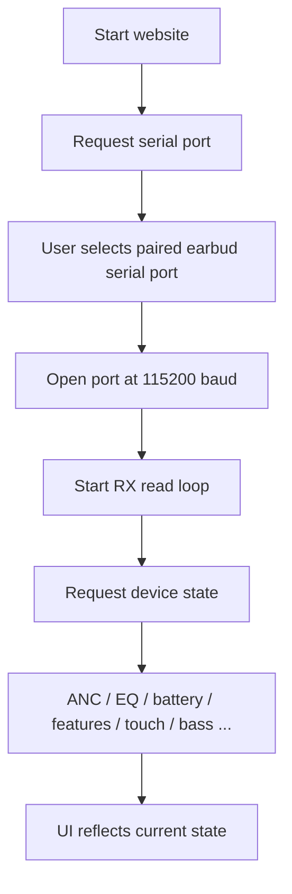
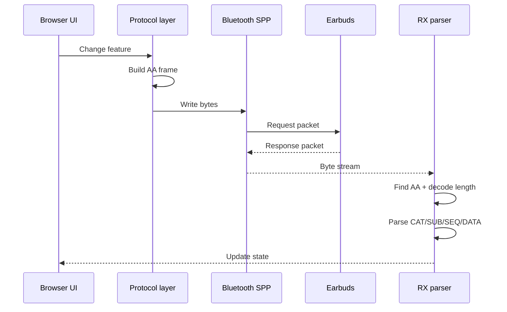
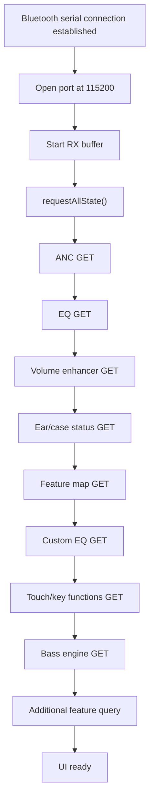
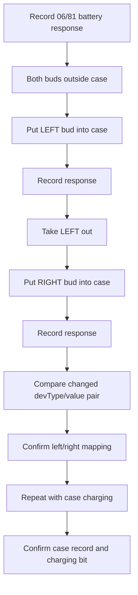
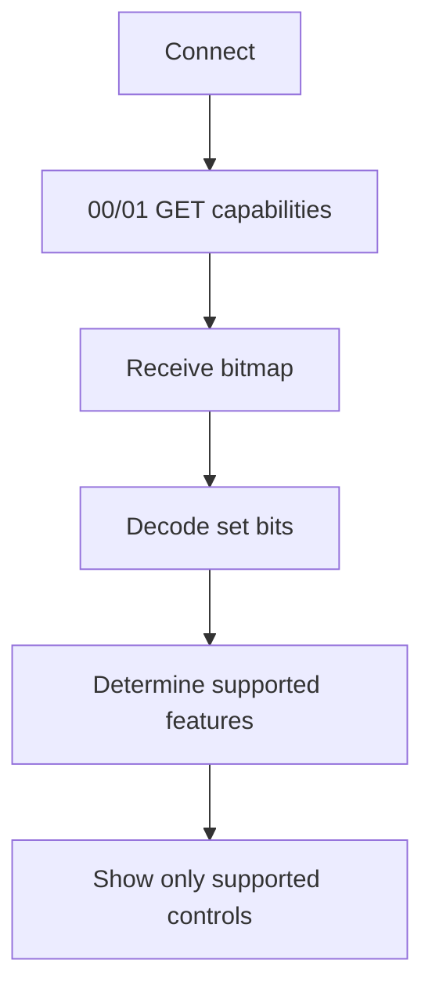
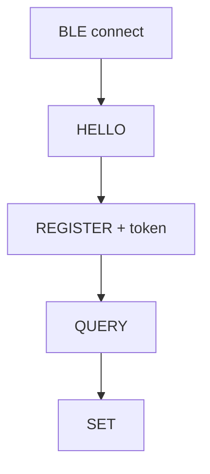
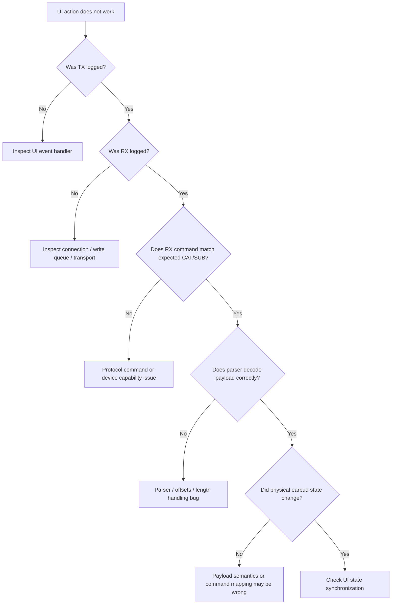
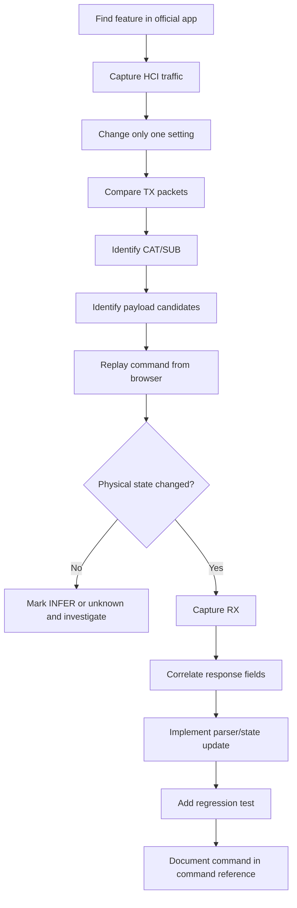

# Realme Web Control

[](#disclaimer)
[](#requirements)
[](#architecture)
[](#protocol-overview)

A browser-based controller for the **Realme Buds Air 5 Pro** & possibly other Realme TWS that communicates with the earbuds without using the Realme Link desktop/phone UI.

The project uses the earbuds' **Bluetooth SPP/RFCOMM serial interface through the browser's Web Serial API**, then sends and receives the proprietary **OPPOv1 / `0xAA` protocol** packets used by the headset firmware.

The project is both:

1. a usable controller for the Buds Air 5 Pro, possibly other Realme TWS and
2. a reverse-engineering / interoperability reference documenting the packet format, command mappings, captures, and known unknowns.

> **Important:** This repository documents behaviour observed on the **Realme Buds Air 5 Pro**. Similar OPPO/OnePlus/Realme devices may use related protocol framing, but command payloads and semantics should not be assumed to be identical across models.

You can check the prototype here: https://realmewebcontrol.vercel.app

---

## Table of contents

- [What this project does](#what-this-project-does)
- [Compatibility](#Compatibility)
- [Architecture](#architecture)
- [How the connection works](#how-the-connection-works)
- [Protocol overview](#protocol-overview)
- [Packet structure](#packet-structure)
- [Request and response flow](#request-and-response-flow)
- [Current command map](#current-command-map)
- [Capability discovery](#capability-discovery)
- [Battery](#battery)
- [Why the project uses Web Serial](#why-the-project-uses-web-serial)
- [Comparison with Aasheesh's OnePlus research](#comparison-with-aasheeshs-oneplus-research)
- [Reverse-engineering methodology](#reverse-engineering-methodology)
- [Project structure](#project-structure)
- [Running the project](#running-the-project)
- [Debugging and finding protocol bugs](#debugging-and-finding-protocol-bugs)
- [Testing plan](#testing-plan)
- [Known issues](#known-issues)
- [Evidence and confidence levels](#evidence-and-confidence-levels)
- [Future work](#future-work)
- [Credits and related work](#credits-and-related-work)
- [Disclaimer](#disclaimer)

---

# What this project does

The controller currently implements or experiments with:

- ANC / Normal / Transparency
- EQ presets
- Custom EQ
- Dynamic Bass
- Volume Enhancer
- Touch controls
- Feature switches
- Battery status
- Earbud / case status
- Automatic reconnect
- Raw TX/RX packet logging

The goal is to communicate with the earbuds directly from a computer rather than relying on the normal Realme Link control UI.

---
## Compatibility

The protocol was originally reverse-engineered and tested on the realme Buds Air 5 Pro, but community testing has shown that the same or closely related protocol is used across several other realme audio products.

> ⚠️ Compatibility is based on community reports and has not been independently verified by the project author on every device. Different models may expose different commands or payloads.

### Tested / Reported Compatibility

| Device | Status | Reported functionality / issues |
|---|---|---|
| **realme Buds Air 5 Pro** | ✅ Primary target | Original device used for reverse-engineering. Full feature set implemented in the project. |
| **realme Buds Air 7 Pro** | ✅ Working | Reported to work; battery percentage for buds/case was requested as a missing feature. |
| **realme Buds Air 7** | 🟡 Working | Basic functionality reported working, but another user reported that the device was not visible in the browser. Compatibility may depend on browser/firmware. |
| **realme Buds Air 8** | 🟡 Partial | Device has been reported working. Another user reported that the device was not detected. Bass control does not work, and enabling HD/LDAC mode can temporarily stop playback until playback is started again. |
| **realme Buds Air 5** | ✅ Mostly working | ANC, EQ, game mode and other basic controls reported working. UI currently displays some Air 5 Pro-specific features such as Spatial Audio. |
| **realme T310** | ✅ Working | Multiple users reported that it works, including one report describing it as working flawlessly. |
| **realme T500 Pro** | ✅ Basic controls | Basic controls reported working and changes sync with the realme Link app quickly. |
| **realme Buds Wireless 5 ANC** | 🟡 Working | Reported working through Brave browser. Feature coverage has not been fully tested. |

### Known Compatibility Issues

#### realme Buds Air 8

Community testing has revealed several differences:

- Device detection can fail in some Chromium-based browsers.
- Bass control does not currently work.
- Enabling HD/LDAC mode can interrupt playback temporarily. Playback resumes after starting it again.
- This suggests that the Air 8 may use different payloads or command mappings for at least some features.

The Air 8 has nevertheless been successfully controlled by multiple users.

#### realme Buds Air 7

Air 7 has been reported working, but another tester reported that the website opened without showing the device. This indicates that compatibility may vary depending on browser, firmware, or the specific Bluetooth implementation.

#### realme Buds Air 5

The non-Pro Air 5 reportedly supports many of the same controls, including:

- ANC
- EQ
- Game mode
- Other basic settings

However, the current UI is designed around the Air 5 Pro and can display features that the Air 5 does not support, such as Spatial Audio.

#### realme T500 Pro

Basic controls have been reported to work, with changes syncing back to the official realme Link app quickly. However, at least one user reported that the project did not work at all on their T500 Pro, so compatibility is not yet considered guaranteed.

### Browser Compatibility Reports

Community testing has included:

- Chrome — working
- Brave — working on some devices
- Firefox — one report of the T500 Pro working on desktop Firefox

The project's primary target remains Chromium-based browsers with Web Serial support. Browser/device combinations outside the original setup may behave differently.

### Community Testing Needed

If you have a realme/OPPO/OnePlus audio device, you can help expand compatibility.

Please report:

1. Exact earbud model
2. Firmware version
3. Browser and operating system
4. Whether the device appears in the connection dialog
5. Which controls work
6. Which controls fail
7. Any errors shown in the serial/debug log

For failed commands, please include the `TX:` and `RX:` entries from the project's serial log where possible.

Do not assume that a command working on one model will work identically on another model. The protocol family appears to be shared across multiple products, but individual models can use different command mappings, payloads, or feature sets.

---

# Architecture

## Full communication stack

```text
┌──────────────────────────────────────────────────────────────┐
│                         BROWSER                              │
│                                                              │
│              React + TypeScript + Web Serial                 │
└──────────────────────────────┬───────────────────────────────┘
                               │
                               │ Web Serial API
                               ▼
┌──────────────────────────────────────────────────────────────┐
│                  OPERATING SYSTEM                            │
│                                                              │
│             Paired Bluetooth device exposed                  │
│                as a serial interface                         │
└──────────────────────────────┬───────────────────────────────┘
                               │
                               │ Bluetooth SPP / RFCOMM
                               ▼
┌──────────────────────────────────────────────────────────────┐
│                 REALME BUDS AIR 5 PRO                       │
│                                                              │
│                   OPPOv1 / 0xAA protocol                     │
└──────────────────────────────────────────────────────────────┘
```

### Important distinction

**Web Serial is not the Bluetooth protocol.**

Web Serial is the browser API used to access the serial interface.

The wireless transport underneath the working implementation is **Bluetooth SPP / RFCOMM**.

The actual earbud command language is the **OPPOv1 / `0xAA` protocol**.

A useful mental model is:

```text
Transport
   │
   ├── Bluetooth SPP / RFCOMM   ← this project
   │
   └── BLE / GATT               ← Aasheesh's project
              │
              ▼
        OPPOv1 / 0xAA
              │
              ▼
        Earbud commands
```

---

# How the connection works

The buds must already be paired with the operating system.

The current connection path is:



The current repository uses:

```ts
navigator.serial.requestPort()
```

and:

```ts
port.open({ baudRate: 115200 })
```

The byte stream does not inherently provide packet boundaries, so the application buffers received bytes and extracts protocol frames.

---

# Protocol overview

The Realme Link headset module identifies the relevant protocol as:

> **OPPO v1**

The protocol uses frames beginning with:

```text
AA
```

The current reverse-engineered implementation treats the frame as:

```text
AA
LEN
CTRL
PAD
CAT
SUB
SEQ
DLEN_LO
DLEN_HI
DATA...
```

Where:

| Field | Meaning |
|---|---|
| `AA` | Start-of-frame |
| `LEN` | LEB128-style variable-length frame length |
| `CTRL` | Fragment/control information |
| `PAD` | Observed zero byte; exact meaning currently unknown |
| `CAT` | Category / feature |
| `SUB` | Operation / verb |
| `SEQ` | Transfer / sequence identifier |
| `DLEN` | Little-endian payload length |
| `DATA` | Command-specific payload |

## Command ID

The command identifier can be represented as:

```text
commandId = (SUB << 8) | CAT
```

A request and response normally retain the same category and sequence.

The response form normally changes the subcommand to:

```text
responseSub = requestSub | 0x80
```

For the commands examined so far, the first response payload byte is a status byte where:

```text
0 = success
```

---

# Packet structure

## Example

A short request can look like:

```text
AA 07 00 00 06 01 00 00 00
```

Conceptually:

```text
┌────┬────┬────┬────┬────┬────┬────┬──────────┬──────┐
│ AA │LEN │CTL │PAD │CAT │SUB │SEQ │   DLEN   │ DATA │
└────┴────┴────┴────┴────┴────┴────┴──────────┴──────┘
  AA   07   00   00   06   01   00   00 00     none
```

For this example:

```text
CAT = 06
SUB = 01
SEQ = 00
DATA = empty
```

which is the battery GET command.

## Length field

The protocol length is **not simply a fixed one- or two-byte integer**.

It is a LEB128-style variable-length integer:

```text
7 bits per byte
bit 7 = continuation bit
```

The current repository only encounters short one-byte lengths in normal use.

## Fragmentation

The protocol has control information for fragmented / multi-frame messages.

The current parser is not yet a full fragmentation/reassembly implementation.

---

# Request and response flow

The normal command flow is:



Every operation should ideally be traceable as:

```text
UI action
   ↓
TX packet
   ↓
RX packet
   ↓
Parser
   ↓
State update
   ↓
UI
```

That makes the application much easier to debug.

---

# Startup state flow

On connection, the current implementation sends a series of state queries approximately **80 ms apart**.



The exact startup list currently used by the repository is documented below.

---

# Current command map

> **Important:** `CAT` alone is not the whole command. The `(CAT, SUB)` combination matters.

## GET / SET table

| Feature | GET | SET | Evidence | Notes |
|---|---|---|---|---|
| Capability bitmap | `00/01` | — | `[APP]` | Capability/feature detection |
| Notification capability | `00/02` | — | `[APP]` | Event capability |
| Battery | `06/01` | — | `[APP]` | Battery records |
| Ear/case status | `09/01` | — | `[APP]` | In-box / in-ear flags; not charging itself |
| Noise control | `0C/01` | `04/04` | `[APP][CODE]` | Realme mode values are device-specific |
| EQ preset | `0F/01` | `06/04` | `[APP][CODE]` | Preset mapping implemented |
| Volume enhancer | `10/01` | `07/04` | `[APP][CODE]` | `0 = off`, `1 = on` |
| Feature switches | `0D/01` | `03/04` | `[APP][CODE]` | Feature IDs are only partly decoded |
| Key functions / touch | `08/01` | `01/04` | `[APP][CODE]` | Tap/action mapping |
| All-EQ data | `22/01` | `18/04` | `[APP][CODE]` | Custom EQ |
| Bass engine | `24/01` | `1B/04` | `[APP][CODE]` | Signed-byte value |
| Notification register | `01/02` | — | `[APP]` | Register for device events |
| Event push | device initiated | — | `[APP][INFER]` | Notification delivery |

---

# Current startup queries

The repository currently requests these categories:

```text
00 []
0C [01 01]
0F []
10 []
09 []
0D [10 07 06 04 05 0B 08 11 13 18 09 1A 0C 1D 1B 36 26]
22 []
08 [0E 01 03 04 05 06 0B 0C 08 0D 11 1F 1A 1B 00]
24 []
0D [01 06]
```

The `00/01` query is **capability discovery**, not battery.

The correct battery GET command is:

```text
06/01
```

---

# ANC

## GET

```text
CAT = 0x0C
SUB = 0x01
```

The observed request includes:

```text
[01 01]
```

## SET

```text
CAT = 0x04
SUB = 0x04
```

Payload:

```text
[01 01 mode]
```

Current Buds Air 5 Pro mapping used by the project:

```text
01 = Normal
02 = Transparency
08 = ANC
```

These values are treated as **device-specific**.

---

# EQ

## GET

```text
0F/01
```

## SET

```text
06/04 [preset]
```

Current preset mapping:

```text
0 = Original
1 = Deep Bass
2 = Serenade
3 = Clear Bass
other = Custom
```

---

# Volume Enhancer

GET:

```text
10/01
```

SET:

```text
07/04 [0|1]
```

---

# Feature switches

GET:

```text
0D/01
```

SET:

```text
03/04 [id, value]
```

A synchronization form follows some changes:

```text
03/05 [sync payload]
```

Several feature IDs have not yet been fully identified.

---

# Touch / key functions

GET:

```text
08/01
```

SET:

```text
01/04
```

The entries encode side/tap/action information.

The current UI exposes:

- Left double tap
- Left triple tap
- Right double tap
- Right triple tap

---

# Custom EQ

GET:

```text
22/01
```

SET:

```text
18/04
```

The current implementation works with six EQ bands.

The exact production EQ frequencies still need confirmation against model-specific configuration.

---

# Dynamic Bass

GET:

```text
24/01
```

SET:

```text
1B/04
```

The value is handled as a signed byte.

---

# Battery

## Correct command

The battery command is:

```text
06/01
```

A short request is:

```text
AA 07 00 00 06 01 <seq> 00 00
```

The response is:

```text
06/81
```

The response format is:

```text
status
count
devType
value
devType
value
...
```

Battery level:

```text
level = value & 0x7F
```

Charging indication:

```text
charging = value & 0x80
```

Current device-type interpretation is:

```text
1 = left
2 = right
3 = case
```

### Important: device type still needs physical verification

The current mapping is based on the reverse-engineered application/repository interpretation and should be confirmed experimentally on the Buds Air 5 Pro.

Do not assume the position of a record means left/right/case.

### Battery verification procedure

Perform these controlled tests:



Do not claim a battery byte is correct merely because its decimal value happens to look plausible.

---

# Capability discovery

The `00/01` command returns a capability bitmap.

This is useful because the device can indicate which command families it supports.

Conceptually:



The decoded mappings currently observed in Realme Link include:

```text
bit 0   -> 05/01
bit 1   -> 06/01 battery
bit 2   -> 07/01
bit 3   -> 08/01 + 01/04 key functions
bit 4   -> 09/01 ear status
bit 5   -> 00/04
bit 6   -> 02/04
bit 7   -> 0D/01 + 03/04 feature switches
bit 8   -> 0C/01 + 04/04 noise control
bit 9   -> 05/04
bit 10  -> 0F/01 + 06/04 EQ
bit 11  -> 10/01 + 07/04 volume enhancer
bit 13  -> 08/04
bit 14  -> 09/04
bit 15  -> 0A/04 + 11/01 auto power off
bit 19  -> 0E/04 + 0D/04 + 15/01 + 16/01 hearing detection/enhancement
bit 22  -> 05/02
bit 23  -> 00/0F
bit 25  -> 18/01 + 11/04 personalized EQ/noise related
bit 26  -> 1A/01 + 12/04 personalized noise reduction
bit 29  -> 12/01 + 0B/04 multi-connect
bit 30  -> 1E/01 + 1F/01 + 15/04 ear scan
bit 32  -> 20/01 language
bit 34  -> 22/01 + 18/04 all-EQ/custom EQ
bit 38  -> 24/01 + 1B/04 bass engine
bit 43  -> 1E/04 spatial audio type
bit 46  -> 28/01 + 0E/05 use time
bit 54  -> 2C/01
bit 58  -> 31/01 + 28/04 AI state/status
bit 60  -> 2C/04 mic state
```

Some command names are known from the application, but their complete payload semantics are still unknown.

---

# Notification flow

The protocol supports registering for events.

Register:

```text
01/02 [eventType]
```

The application handles event types including:

| Event type | Meaning |
|---|---|
| `1` | Battery |
| `2` | Ear/case status |
| `3` | Noise reduction changed |
| `4` | Ear-fit / compactness detection |
| `14` | Ear scan result |
| `15` | Public event such as volume / AI state |
| `F1` | User interaction / button events |

After registration, the device can push notifications.

The exact device-originated event framing should be treated as partially inferred until independently captured and verified on this model.

---

# Why the project uses Web Serial

The browser implementation does **not** communicate with the earbuds through a cable.

The working path is:

```text
Realme Buds
    ↑
Bluetooth SPP / RFCOMM
    ↑
Operating system exposes serial port
    ↑
Web Serial API
    ↑
Browser
```

This differs from BLE/GATT.

### Web Serial / SPP

```text
Browser
  ↓
Web Serial
  ↓
Serial port
  ↓
Bluetooth SPP / RFCOMM
  ↓
Earbuds
```

### BLE / GATT

```text
Application
  ↓
Bluetooth Core API
  ↓
BLE
  ↓
GATT service
  ↓
Characteristic read/write/notify
  ↓
Earbuds
```

The transport and the protocol are separate layers.

---

# Comparison with Aasheesh's OnePlus research

A related public reverse-engineering project by **Aasheesh** targets the **OnePlus Nord Buds 3 Pro**.

Repository:

https://github.com/AasheeshLikePanner/cracked-oneplus-buds

Write-up:

https://aasheesh.vercel.app/blog/oneplus-buds

Aasheesh's project uses **BLE/GATT on macOS**.

This repository uses **Bluetooth SPP/RFCOMM exposed through Web Serial**.

The transport mechanisms are different, but both implementations communicate using the same general **OPPOv1 / `0xAA` protocol family**.

## Transport comparison

| | This project | Aasheesh |
|---|---|---|
| Earbuds | Realme Buds Air 5 Pro | OnePlus Nord Buds 3 Pro |
| Host | Browser | macOS application |
| API | Web Serial | CoreBluetooth |
| Bluetooth transport | SPP / RFCOMM | BLE / GATT |
| Protocol family | OPPOv1 / `0xAA` | OPPOv1 / `0xAA` |
| Visible handshake | Not required by current SPP path | HELLO + REGISTER |
| Main purpose | Desktop/browser control + protocol research | OnePlus controller + protocol research |

## Shared protocol concept

Both projects use the same general family of:

```text
AA
LEN
...
CAT
SUB
SEQ
DATA
```

The exact command behaviour can still differ between devices.

### Battery

Both implementations use:

```text
06/01
```

for battery GET.

### ANC

Both implementations use:

```text
04/04
```

for ANC SET.

However, the **ANC mode values differ**:

```text
OnePlus:
01 = ANC
02 = Transparency
04 = Off

Realme:
08 = ANC
02 = Transparency
01 = Normal
```

Therefore, protocol family compatibility does **not** imply identical payload semantics.

## Handshake difference

Aasheesh's OnePlus BLE implementation uses:



The current Realme SPP implementation does not use the same visible HELLO/REGISTER sequence.

The exact reason for this transport/device difference is not yet proven.

---

# Reverse-engineering methodology

The project follows a simple rule:

> **Observe first. Infer second. Test third.**

## 1. Capture

Bluetooth HCI / btsnoop captures were used to record communication between the official application and the earbuds.

Example:

```text
TX:
AA ...

RX:
AA ...
```

## 2. Correlate packets with actions

A feature is changed in Realme Link and the corresponding packets are compared.

Useful experiments include:

- ANC Normal → ANC
- ANC → Transparency
- EQ preset A → EQ preset B
- Dynamic Bass slider changes
- Touch assignment changes
- Earbud enters charging case
- Earbud leaves charging case
- connection / disconnection

## 3. Compare

Look for bytes that consistently change with the controlled action.

## 4. Reproduce

Send the candidate command from the browser implementation.

## 5. Verify

Check both:

- the raw response, and
- the real physical/device state.

## Evidence hierarchy

```text
Bluetooth capture
      ↓
Observed packet behaviour
      ↓
Working implementation
      ↓
Decompiler / application code
      ↓
Inference / hypothesis
```

A decompiled function name alone is not enough to prove a payload field.

---

# Project structure

```text
Realme-Web-Control/
│
├── README.md
│
├── docs/
│   ├── PROTOCOL.md
│   ├── COMMAND_REFERENCE.md
│   ├── REVERSE_ENGINEERING.md
│   ├── TESTING.md
│   └── AASHEESH_COMPARISON.md
│
├── src/
│   ├── components/
│   ├── hooks/
│   │   └── useSerial.ts
│   └── pages/
│
└── captures/
```

## Important source files

| File | Purpose |
|---|---|
| `src/hooks/useSerial.ts` | Connection, TX, RX, framing, parsing, state |
| `src/pages/Index.tsx` | Main page/state wiring |
| `src/components/NoiseControlCard.tsx` | ANC controls |
| `src/components/EQPresetCard.tsx` | EQ presets |
| `src/components/CustomEQCard.tsx` | Custom EQ |
| `src/components/DynamicBassCard.tsx` | Dynamic Bass |
| `src/components/TouchControlsCard.tsx` | Touch mappings |
| `src/components/SystemFeaturesCard.tsx` | Feature switches |
| `src/components/SerialLog.tsx` | Raw TX/RX logging |
| `src/components/HeaderBar.tsx` | Connection state + battery UI |

---

# Running the project

## Requirements

- Realme Buds Air 5 Pro
- Bluetooth pairing with the computer
- Chrome or Edge
- HTTPS or localhost
- Operating system support for exposing the paired earbuds as a serial port

The earbuds must already be paired before opening the application.

## Install

```bash
git clone <repository-url>
cd Realme-Web-Control
npm install
```

## Development

```bash
npm run dev
```

Open the local URL shown by Vite.

Then:

1. Pair the earbuds with the OS.
2. Open the website.
3. Connect to the serial port corresponding to the earbuds.
4. Watch the Serial Log.
5. Verify the startup queries and responses.

---

# Debugging and finding protocol bugs

The **Serial Log is the first place to look**.

Every operation should ideally show:

```text
TX: ...
RX: ...
STATE: ...
```

## Debugging flow



---

## Common failure modes

### 1. TX never appears

Possible causes:

- UI callback not firing
- serial port unavailable
- writer locked
- write queue race

Look for:

```text
TX:
```

If there is no TX line, the bug is probably above the protocol layer.

---

### 2. TX appears but no RX

Check:

- Bluetooth connection
- serial port state
- reconnect state
- write completion
- whether the command is supported

---

### 3. RX appears but state is wrong

Compare:

```text
CAT
SUB
SEQ
DLEN
DATA
```

against a known working capture.

The most common mistake in reverse-engineering is assuming fixed byte offsets that are not actually part of the field definition.

---

### 4. UI state is wrong but packet is correct

Check the parser-to-state path:

```text
RX packet
    ↓
processRxBuffer
    ↓
parse command
    ↓
updateState
    ↓
React component
```

A correct packet with a wrong UI value is usually a state/parser/UI problem, not a transport problem.

---

# Testing plan

Protocol work should be tested against the physical earbuds rather than only against expected numbers.

## Battery

1. Connect.
2. Capture `06/01` request and `06/81` response.
3. Record both-buds-out state.
4. Put left bud in case.
5. Record response.
6. Put left bud back out.
7. Put right bud in case.
8. Record response.
9. Test case charging.
10. Confirm battery level and charging-bit interpretation.

## ANC

Cycle:

```text
Normal
↓
Transparency
↓
ANC
↓
Normal
```

For each:

- record TX
- record RX
- verify physical mode
- verify subsequent GET state

## EQ

Test:

```text
Original
Deep Bass
Serenade
Clear Bass
Custom
```

Confirm the SET and subsequent GET match.

## Dynamic Bass

Test:

```text
minimum
25%
50%
75%
maximum
```

Then repeat quickly to expose write races.

## Touch controls

Test each currently supported mapping:

```text
Left double
Left triple
Right double
Right triple
```

Verify physical behaviour.

## Reconnect

Test:

```text
connected
↓
Bluetooth disconnect
↓
Bluetooth reconnect
↓
automatic reconnect
↓
state queries
```

## Parser robustness

Test:

- multiple frames received together
- frame split across reads
- bytes before `AA`
- incomplete frame
- longer frame
- fragmented response

---

# Known issues

## Battery

The previous repository implementation treated:

```text
00/01
```

as battery.

This is actually:

```text
GET CAPABILITIES
```

The correct battery query is:

```text
06/01
```

The old parser also used fixed offsets and could accidentally interpret unrelated bytes as plausible percentages.

Battery parsing should use:

```text
status
count
(devType, value)...
```

and:

```text
value & 0x7F
```

for the level.

Live polling is still required for continuously updated battery UI.

---

## Serial write race

Rapid slider changes can issue overlapping writes.

A queued write path is preferable:


The queue prevents concurrent `getWriter()` calls from colliding.

---

## Frame parser

The current parser handles normal short frames but does not completely implement:

- multi-byte LEB128 lengths
- fragmentation
- fragmented reply reassembly

This is acceptable for currently observed packets but should be improved for a complete protocol implementation.

---

## Reconnect

Automatic reconnect retries are present, but the current implementation can reach a dead end after repeated failures.

An explicit reconnect button should be available.

---

# Evidence and confidence levels

Every protocol claim should use one of these labels.

| Tag | Meaning |
|---|---|
| `[APP]` | Read directly in the decompiled Realme Link implementation |
| `[CODE]` | Implemented / observed working on the Buds Air 5 Pro |
| `[INFER]` | Plausible interpretation, not fully proven |
| `[?]` | Unknown / unverified |

## Example

```text
06/01 = Battery GET [APP]
```

is stronger than:

```text
payload byte 5 = left battery [INFER]
```

### Golden rule

**Never assign meaning to a byte just because the number looks correct.**

For example, if a packet contains:

```text
2F 5A 64
```

it is not sufficient evidence that this means:

```text
47% / 90% / 100%
```

A controlled battery experiment is required to prove the mapping.

---

# Other commands discovered in Realme Link

The decompiled application contains additional command IDs whose names are known but whose complete payload semantics are not yet understood.

| Command | Current interpretation | Status |
|---|---|---|
| `0A/04` | Auto power off SET | `[APP]` ID, payload unknown |
| `28/04` | AI status SET | `[APP]` ID, payload unknown |
| `31/01` | AI state GET | `[APP]` ID, semantics incomplete |
| `2C/04` | Mic state SET | `[APP]` ID, payload unknown |
| `0B/04` | Multi-connect action | `[APP]` ID, payload unknown |
| `1E/04` | Spatial audio type SET | `[APP]` ID, payload unknown |
| `12/04` | Personalized noise reduction SET | `[APP]` ID, payload unknown |
| `15/01` | Hearing enhancement GET | `[APP]` ID, semantics incomplete |
| `1E/01` | Ear scan GET | `[APP]` ID, payload unknown |
| `1F/01` | Ear scan GET | `[APP]` ID, payload unknown |
| `15/04` | Ear scan SET | `[APP]` ID, payload unknown |
| `20/01` | Language GET | `[APP]` ID, payload unknown |

**Do not send unverified commands blindly to the device.**

---

# What to do when adding a new command

Use this workflow:



This keeps protocol discovery reproducible for anyone contributing to the repository.

---

# Current project status

| Area | Status |
|---|---|
| Bluetooth SPP / RFCOMM transport | ✅ Confirmed |
| Web Serial transport | ✅ Confirmed |
| OPPOv1 / `0xAA` framing | ✅ Confirmed |
| ANC | ✅ Working |
| EQ | ✅ Working |
| Volume Enhancer | ✅ Working |
| Dynamic Bass | ✅ Working |
| Touch controls | ✅ Working |
| Feature switches | ✅ Working |
| Battery command ID | ✅ Confirmed |
| Battery parser / device-type mapping | 🟡 Needs physical verification |
| Battery live polling | 🟡 To implement |
| Notification events | 🟡 Partially understood |
| Capability decoding | ✅ Documented |
| Full fragmentation support | 🟡 To implement |
| Additional undocumented commands | ❓ Ongoing |

---

# Future work

The most useful next steps are:

1. Verify the battery device-type mapping on physical hardware.
2. Add live battery polling.
3. Add a serialized write queue.
4. Implement full LEB128 frame-length handling.
5. Add fragmentation / reassembly.
6. Add a visible reconnect button.
7. Use the capability bitmap to dynamically show supported controls.
8. Reverse-engineer notification/event pushes.
9. Investigate additional capability-gated commands.
10. Test the protocol across additional OPPO / OnePlus / Realme models where hardware access is available.

---

# Credits and related work

This project was developed as an independent reverse-engineering effort for the Realme Buds Air 5 Pro.

A closely related public project is:

**AasheeshLikePanner — Cracked OnePlus Buds**

Repository:

https://github.com/AasheeshLikePanner/cracked-oneplus-buds

Write-up:

https://aasheesh.vercel.app/blog/oneplus-buds

That project was particularly useful as comparative evidence for the broader OPOv1 protocol family and demonstrates a different transport path:

```text
CoreBluetooth
    ↓
BLE / GATT
    ↓
OPOv1
    ↓
OnePlus Buds
```

This project instead uses:

```text
Web Serial
    ↓
Bluetooth SPP / RFCOMM
    ↓
OPOv1
    ↓
Realme Buds Air 5 Pro
```

The two projects should be viewed as related reverse-engineering efforts rather than one being a direct port of the other.

---

# Disclaimer

This is an unofficial project and is not affiliated with:

- Realme
- OPPO
- OnePlus

No proprietary Realme Link source code is intended to be included in this repository.

Protocol documentation is based on observed Bluetooth traffic, working interoperability code, reverse-engineering of the relevant application module, and explicitly marked inference.

Use the software at your own risk.

## License

MIT License

Copyright (c) 2026 DuGanTaDa

If you fork, modify, or build upon this project, please retain the
original copyright notice and credit the original project:

**Original project:** Realme-Web-Control [https://github.com/DuGanTaDa/Realme-Web-Control]

**Author:** DuGanTaDa

Realme, OPPO, OnePlus, Realme Link, and related names and trademarks belong
to their respective owners. This project is unofficial and is not affiliated
with or endorsed by Realme, OPPO, or OnePlus.

The reverse-engineering findings are provided for interoperability,
research, and educational purposes.
